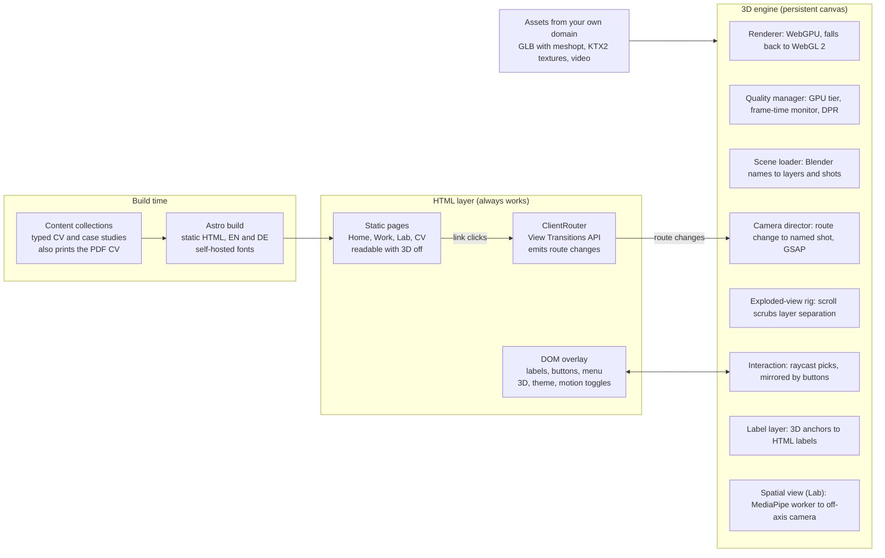
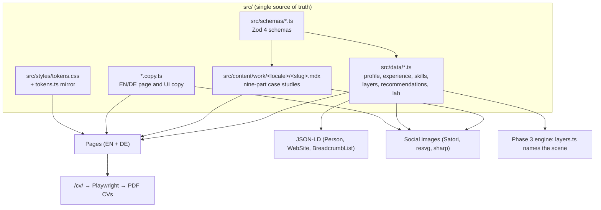
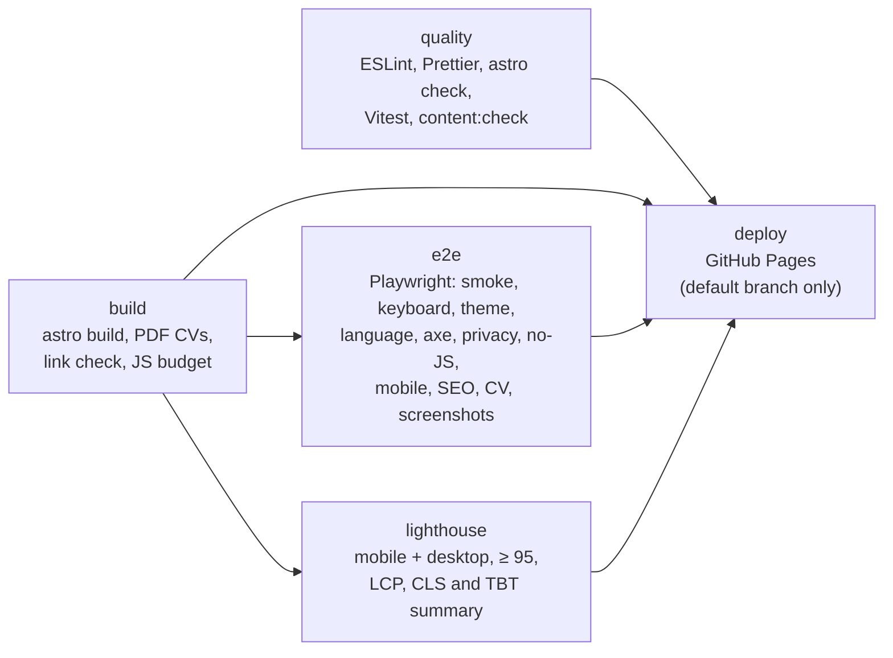

# Architecture

"Systems, shipped": static HTML first, then (from Phase 3) one persistent WebGPU canvas that survives page navigation. The HTML works on its own; the canvas is decorative.

## Site architecture (brief §6)



The pages work on their own; the router tells the canvas which camera shot to fly to, and HTML labels and buttons mirror every clickable layer.

## One typed source, many outputs



Skill and stack items are terms: a product name is one string for both locales, a descriptive phrase an `{ en, de }` pair, rendered with `term()` from `src/i18n/term.ts` (DECISIONS D-022).

## Repository map

```text
site.config.ts            SITE_URL and BASE_PATH (the only place they are defined)
astro.config.ts           Astro: static output, i18n, fonts, MDX, sitemap (hreflang en, de, x-default), markdown processor
src/
  pages/                  Thin route files. English at the root, German under de/; each renders a view
    de/                   German twins of every route (same slugs)
    og/[...slug].png.ts   Build-time social images
    robots.txt.ts, 404.astro, tokens.astro
  views/<page>/           Page bodies (+ <page>.copy.ts for page copy)
  views/legal/            Shared legal shell (LegalPage, LegalBlocks), content model and feature flags (legal.ts),
                          shared copy (legal.copy.ts); used by impressum/ and datenschutz/
  components/
    layout/               Header, Footer, SkipLink, ThemeToggle, Fonts
    ui/                   Shared parts: Section, SectionLabel, PageHeader, CompactSection, FactList, Points,
                          DateRange, ArrowLink, ExternalLink, CopyEmail, StatusChip, PlannedChip, Quote,
                          Rich (placeholders), Icon
    home/                 Hero, quick facts, Fig. 1 (StackFigure, stack-geometry.ts) and its HTML mirror
                          (StackLegend), the home sections
    work/                 WorkCard, ProseLink (external links in MDX), diagrams/ (one SVG component per case
                          study, DiagramFrame, DNode, DBalloon, steps.ts, diagrams.copy.ts)
    about/                Portrait, Thread, AboutFacts
    experience/           TimelineEntry, EducationEntry
    lab/                  HoloBoxPreview, RobotArchive, StudentArchive
    colophon/             StackList, BudgetTable
    cv/                   CvHeader, CvContact, CvSection, CvEntry, CvSkills, CvLanguages, CvInlineList
    seo/                  Seo (title, canonical, hreflang, Open Graph, JSON-LD)
  layouts/BaseLayout.astro The one layout: theme script, fonts, SEO, head slot, ClientRouter, #stage, header, footer
  content.config.ts       Content collections (Content Layer API)
  content/work/           Case studies: <locale>/<slug>.mdx
  data/                   Typed, validated CV data (also importable by the 3D engine)
  schemas/                Zod schemas for data and case studies (common.ts: l10n, term, dates, placeholders)
  i18n/                   Locales, routes, formatting (Intl), term() for skill and stack terms, UI copy, page meta
  lib/                    URL helpers, preferences, theme script, placeholders (+ rehype plugin), contrast,
                          CV/PDF names, JSON-LD builders, work collection helpers, og.ts (social image paths)
    og/                   cards.ts (what each social image says), stack.ts (isometric stack geometry),
                          render.ts (Satori, resvg, sharp)
  styles/                 tokens.css (source of truth, print tokens included), tokens.ts (typed mirror),
                          global.css, print.css (the CV's A4 sheet)
  engine/                 Phase 3 module skeleton (README stubs only)
scripts/                  serve-dist, build-pdf, check-links, content-check, js-size-report, lhci
tests/unit/               Vitest: schemas and terms, EN/DE parity, formatting, URL policy, tokens, SEO
tests/e2e/                Playwright: smoke, keyboard, theme, language, axe, privacy, no-JS, mobile, SEO, CV,
                          screenshots
.github/workflows/ci.yml  CI on every push and PR; deploy on the default branch
```

## Routing and URLs

- English at the root, German under `/de/`, identical slugs (`/work/happ/` ↔ `/de/work/happ/`).
- `trailingSlash: 'always'`; every internal URL is built with `withBase()` / `href()` / `routeHref()` / `workHref()`. Never hard-code `/medlkhl2.github.io`.
- Canonical, `hreflang` (`en`, `de`, `x-default`) and `og:url` are absolute (`SITE_URL + BASE_PATH`). The sitemap lists the same three alternates for every URL and leaves out `/tokens/` and the 404 page.
- GitHub Pages serves one `404.html` for every missing URL, so the 404 page is bilingual and uses absolute links.
- Everything that serves `dist/` (Playwright, the PDF printer, Lighthouse CI) uses `scripts/serve-dist.mjs`, which mirrors GitHub Pages (base path, `/x` → `/x/` redirects, 404 page).

## Theming and preferences

- Tokens: `src/styles/tokens.css` defines colour (graphite and paper), type, space, grid, lines, radii, z-layers, focus, touch targets, motion and print. `src/styles/tokens.ts` mirrors them for code; a unit test fails if they drift.
- `data-theme` on `<html>` is set before first paint by an inline script (`src/lib/theme-script.ts`) and re-applied on `astro:after-swap`.
- `src/lib/prefs.ts` is the typed preferences module (theme, motion, 3D, language). It persists choices, honours `prefers-reduced-motion` and `Save-Data`, writes `data-theme`, `data-motion`, `data-save-data` and `data-3d` on `<html>`, and emits `prefs:change` on `document`.
- In print, a block at the end of `tokens.css` forces the paper palette on white whatever the theme; the CV's A4 sheet (`src/styles/print.css`) takes its root size, leading, page margins and photo size from the `--print-*` tokens.

## Hooks for later phases (inert in Phase 1)

- `<div id="stage" aria-hidden="true" transition:persist="stage">` in `BaseLayout`: the persistent canvas container, hidden while empty.
- `<body data-scene-shot data-active-layer>`: each page's camera shot and highlighted layer, for example `cam_work_happ` and `layer_identity` on the HAPP case study, `none` on pages without a 3D view (CV, legal pages, 404). The values come from `src/data/scene.ts` and the case-study frontmatter `scene`.
- Home Fig. 1 (`src/components/home/StackFigure.astro`): each slab is `<g id="stack-layer-<id>" data-layer="<id>">`, the figure wrapper carries `data-stack-poster` (the poster the canvas fades in over) and the hero carries `data-stack-root` (the common ancestor of figure and list that scopes the `:has()` highlight). The HTML mirror's items are `<li id="layer-<id>" data-layer-item="<id>">`; links to `#layer-<id>` highlight a slab.
- Case-study diagrams: each step is `<g data-step="<id>">` in the SVG and `<li id="step-<id>" data-step="<id>">` in the step list, so Phase 2 can highlight the active step as its paragraph scrolls into view. The ids come from the frontmatter; the build fails on a mismatch.
- `src/data/layers.ts`: layer ids, labels, skills and case studies; mesh names `layer_<id>` and label anchors `lbl_<id>` for the Blender scene.
- `src/engine/`: module skeleton from brief §6 (README stubs).
- Client scripts bind on `astro:page-load` and clean up on `astro:before-swap`, so the persistent canvas needs no rewrites.

## Quality pipeline



| Suite                           | What it checks                                                                                                                                                          |
| ------------------------------- | ----------------------------------------------------------------------------------------------------------------------------------------------------------------------- |
| `tests/unit/schemas.test.ts`    | Data and case-study frontmatter against the Zod schemas, skill and stack terms in both locales, no phone number, birth date or street address                           |
| `tests/unit/parity.test.ts`     | Every `*.copy.ts` module, page twin and case-study structure in both locales                                                                                            |
| `tests/unit/format.test.ts`     | Year-months, ranges (`formatRange`, `formatRangeParts`), durations, dates and lists per locale                                                                          |
| `tests/unit/url.test.ts`        | Base path, trailing slashes, locale mapping, PDF links                                                                                                                  |
| `tests/unit/tokens.test.ts`     | `tokens.css` ↔ `tokens.ts` (themes, no-JS fallback, print, targets, motion) and WCAG contrast                                                                           |
| `tests/unit/seo.test.ts`        | JSON-LD builders and their privacy guard, page meta lengths and uniqueness, social cards, the legal content model                                                       |
| `tests/e2e/smoke.spec.ts`       | Every route in both locales; unknown URLs get the 404 page                                                                                                              |
| `tests/e2e/keyboard.spec.ts`    | Skip link to main, the home page's "Skip the parts list" link, visible focus                                                                                            |
| `tests/e2e/theme.spec.ts`       | First visit follows the system, the choice persists, `color-scheme` matches                                                                                             |
| `tests/e2e/i18n.spec.ts`        | The language switch lands on the twin and remembers the choice, hreflang alternates, no switch on the 404 page                                                          |
| `tests/e2e/a11y.spec.ts`        | axe (WCAG 2.2 AA) on every page and `/tokens/`, in both themes                                                                                                          |
| `tests/e2e/privacy.spec.ts`     | On every page: zero third-party requests, no cookies, no embeds, no `tel:` links or phone numbers                                                                       |
| `tests/e2e/nojs.spec.ts`        | The home page's first screen without JavaScript at 1440 × 900 and 390 × 844, header links unclipped at 320 and 390 px, every page renders, the theme follows the system |
| `tests/e2e/mobile.spec.ts`      | The menu at 390 px (tab order, steady row, Escape returns focus), 44 px controls, no horizontal scroll                                                                  |
| `tests/e2e/header.spec.ts`      | The home page's section highlight (set, cleared, kept below the last section), `aria-current` on the Work link                                                          |
| `tests/e2e/seo.spec.ts`         | Head metadata, social images, JSON-LD, unique titles and descriptions, the sitemap's hreflang set, robots.txt, the 404, legal pages                                     |
| `tests/e2e/cv.spec.ts`          | PDF downloads (file name, `application/pdf`, at most 2 pages), hreflang on the other-language link, the print sheet                                                     |
| `tests/e2e/screenshots.spec.ts` | Gate screenshots of every route, both locales and themes, at 1440 × 900 and 390 × 844 (only with `SCREENSHOTS=1`)                                                       |
