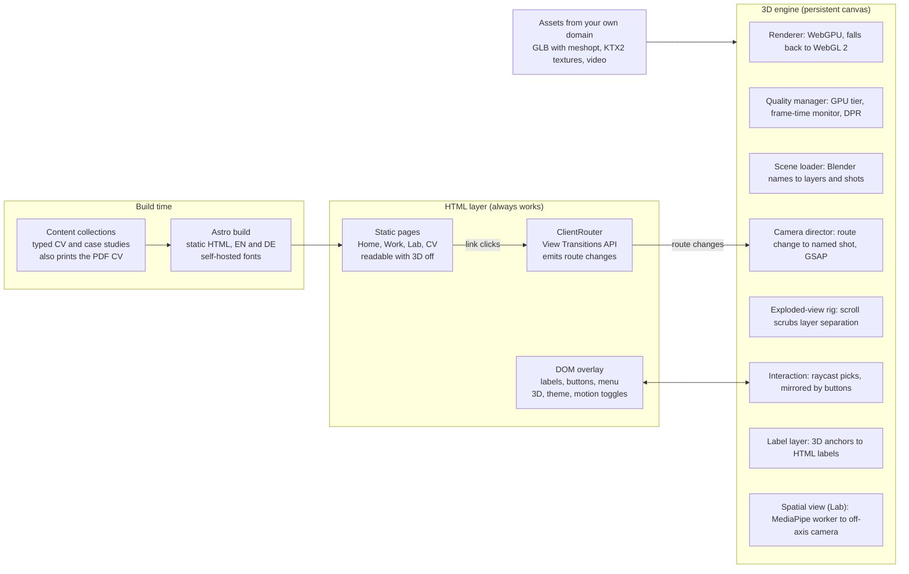
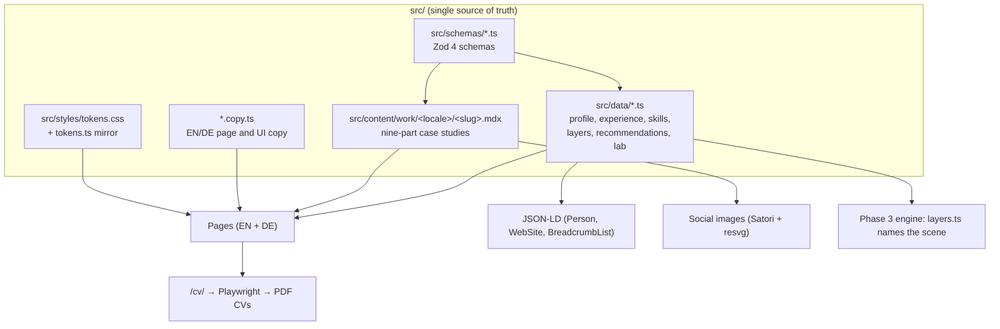
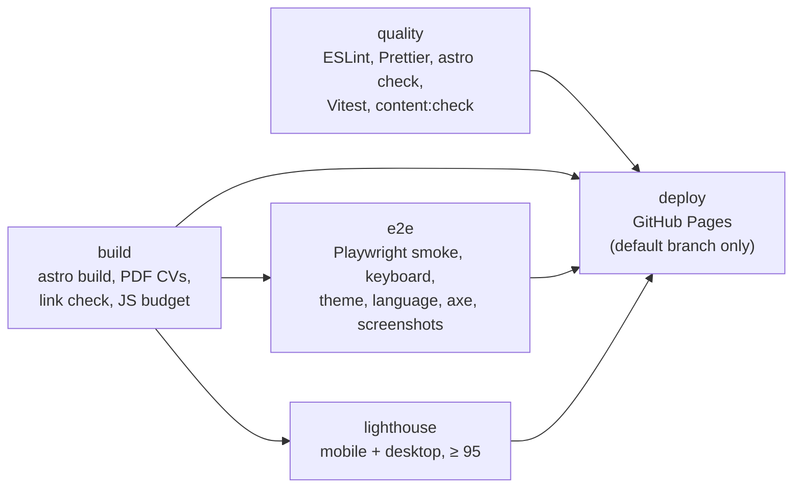

# Architecture

"Systems, shipped": static HTML first, then (from Phase 3) one persistent WebGPU canvas that survives page navigation. The HTML works on its own; the canvas is decorative.

## Site architecture (brief §6)



The pages work on their own; the router tells the canvas which camera shot to fly to, and HTML labels and buttons mirror every clickable layer.

## One typed source, many outputs



## Repository map

```text
site.config.ts            SITE_URL and BASE_PATH (the only place they are defined)
astro.config.ts           Astro: static output, i18n, fonts, MDX, sitemap, markdown processor
src/
  pages/                  Thin route files. English at the root, German under de/; each renders a view
    de/                   German twins of every route (same slugs)
    og/[...slug].png.ts   Build-time social images
    robots.txt.ts, 404.astro, tokens.astro
  views/<page>/           Page bodies (+ <page>.copy.ts for page copy)
  components/
    layout/               Header, Footer, SkipLink, ThemeToggle, Fonts
    ui/                   Icon, Rich (placeholders), SectionLabel, StatusChip, CopyEmail
    seo/                  Seo (title, canonical, hreflang, Open Graph, JSON-LD)
  layouts/BaseLayout.astro The one layout: theme script, fonts, SEO, ClientRouter, #stage, header, footer
  content.config.ts       Content collections (Content Layer API)
  content/work/           Case studies: <locale>/<slug>.mdx
  data/                   Typed, validated CV data (also importable by the 3D engine)
  schemas/                Zod schemas for data and case studies
  i18n/                   Locales, routes, formatting (Intl), UI copy, page meta
  lib/                    URL helpers, preferences, placeholders, contrast, CV/PDF names, OG renderer
  styles/                 tokens.css (source of truth), tokens.ts (typed mirror), global.css
  engine/                 Phase 3 module skeleton (README stubs only)
scripts/                  serve-dist, build-pdf, check-links, content-check, js-size-report, lhci
tests/unit/               Vitest: schemas, EN/DE parity, formatting, URL policy, tokens
tests/e2e/                Playwright: smoke, keyboard, theme, language, axe, screenshots
.github/workflows/ci.yml  CI on every push and PR; deploy on the default branch
```

## Routing and URLs

- English at the root, German under `/de/`, identical slugs (`/work/happ/` ↔ `/de/work/happ/`).
- `trailingSlash: 'always'`; every internal URL is built with `withBase()` / `href()` / `routeHref()` / `workHref()`. Never hard-code `/medlkhl2.github.io`.
- Canonical, `hreflang` (`en`, `de`, `x-default`) and `og:url` are absolute (`SITE_URL + BASE_PATH`).
- GitHub Pages serves one `404.html` for every missing URL, so the 404 page is bilingual and uses absolute links.
- Everything that serves `dist/` (Playwright, the PDF printer, Lighthouse CI) uses `scripts/serve-dist.mjs`, which mirrors GitHub Pages (base path, `/x` → `/x/` redirects, 404 page).

## Theming and preferences

- Tokens: `src/styles/tokens.css` defines colour (graphite and paper), type, space, grid, lines, radii, z-layers, focus and motion. `src/styles/tokens.ts` mirrors them for code; a unit test fails if they drift.
- `data-theme` on `<html>` is set before first paint by an inline script (`src/lib/theme-script.ts`) and re-applied on `astro:after-swap`.
- `src/lib/prefs.ts` is the typed preferences module (theme, motion, 3D, language). It persists choices, honours `prefers-reduced-motion` and `Save-Data`, writes `data-theme`, `data-motion`, `data-save-data` and `data-3d` on `<html>`, and emits `prefs:change` on `document`.

## Hooks for later phases (inert in Phase 1)

- `<div id="stage" aria-hidden="true" transition:persist="stage">` in `BaseLayout`: the persistent canvas container.
- `<body data-scene-shot="cam_home" data-active-layer="layer_identity">`: each page's camera shot and highlighted layer (`src/data/scene.ts`, case-study frontmatter `scene`).
- `src/data/layers.ts`: layer ids, labels, skills and case studies; mesh names `layer_<id>` and label anchors `lbl_<id>` for the Blender scene.
- `src/engine/`: module skeleton from brief §6 (README stubs).
- Client scripts bind on `astro:page-load` and clean up on `astro:before-swap`, so the persistent canvas needs no rewrites.

## Quality pipeline


