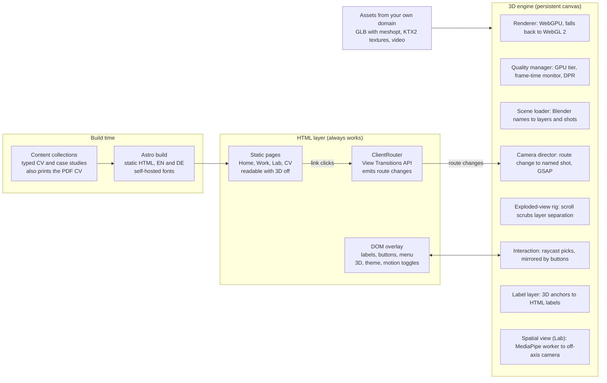
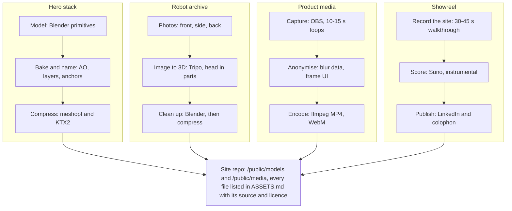

# Senior Engineer Portfolio — Research + Build Brief for Opus

> Exported from the Claude Docs brief on 2026-11-01 (rev 54). The three diagrams of the original doc are included below as Mermaid/table text versions.

Nov 1, 2026 · @Mohamed

## 1. How to use this brief

Hand this whole document to Opus as the project spec, then run the build one phase at a time with your sign-off between phases.

1. Export this doc as Markdown and save it in the new repo root as `PORTFOLIO_BRIEF.md`.
2. Paste the master prompt (section 13) as the first message. It makes Opus read the brief, restate the plan and list open questions before it writes code.
3. Answer the questions in section 15 first. Opus can build around missing assets, but not around missing content.
4. Run one phase per session. Each phase ends at a gate: screenshots or a short screen recording, the performance numbers, and a checklist against that phase's acceptance criteria. You approve or send fixes.
5. Make assets in parallel with the build (section 9). Opus builds against simple stand-in shapes, so asset work never blocks code.

## 2. Executive summary

Build a fast, precise, bilingual portfolio that reads like a senior engineer's case file, with one signature 3D piece that proves craft without getting in the way.

- **Positioning.** Senior Software Engineer and Team Lead: 5+ years of cross-platform .NET (MAUI, Xamarin, ASP.NET Core), leadership of a 7-person team, secure enterprise apps, and now on-device AI. One clear line, not a wall of tool names.
- **Signature piece.** An exploded architecture view: a mobile app and its backend separate into labelled layers (UI, view models, domain, APIs, identity, data, CI/CD) as the visitor scrolls. It shows systems thinking and real-time 3D skill in a single gesture.
- **Proof.** Three case studies with outcomes: your HAPP work at Anton-Haering as the flagship (with permission), HoloBox as the applied-AI project, and your robotics work as the foundation. Add an experience timeline, recommendations, and a CV generated from the same data in English and German.
- **AI, presented professionally.** HoloBox appears as an engineering case study (local LLM inside .NET MAUI, speech, head-tracked 3D). Its head tracking also powers an opt-in "spatial view" of the hero model in the Lab.
- **Recruiter fast path.** Name, role, quick facts, CV and contact on the first screen; a command palette (Ctrl or ⌘ + K); a classic mode without 3D.
- **Stack.** Astro, three.js on WebGPU with TSL, GSAP and Lenis. Content lives in HTML; 3D is a progressive enhancement.
- **Plan.** Seven phases with approval gates, launchable after phase 2. Set a launch date before you start, because a portfolio has no client deadline ([Bruno Simon's case study](https://www.awwwards.com/brunos-portfolio-case-study.html)).

## 3. What the best engineering portfolios do now

The portfolios that win senior roles are scannable in seconds, prove impact with specifics, and show craft in small details; 3D earns its place when it explains something.

| Pattern | Benchmark | Lesson for your build |
| --- | --- | --- |
| Experience first, easy to scan | [Brittany Chiang](https://brittanychiang.com/), senior frontend engineer: dark single page, sticky left navigation between experience, projects and writing, technologies listed per role ([Hostinger](https://www.hostinger.com/ca/tutorials/web-developer-portfolio/)); a cursor-following glow and navigation that highlights as sections scroll into view ([WeAreDevelopers](https://www.wearedevelopers.com/magazine/561-web-developer-portfolio-inspiration-and-examples-march-2025-561)) | Role, experience and selected work come first; navigation stays visible. |
| Craft in the details | [Rauno Freiberg](https://rauno.me): meticulous animation, spacing and typography ([Made Good Designs](https://madegooddesigns.com/graphic-design-portfolio-examples/)) | Polish signals how you treat production work: focus states, alignment, transitions. |
| Shipped tools as proof | Paco Coursey (Linear, previously Vercel) keeps his site mostly text and points to products people use, such as the cmdk command menu ([Hostinger](https://www.hostinger.com/ca/tutorials/web-developer-portfolio/)) | Link real artefacts: repos, store listings, demos. A command menu doubles as a craft signal. |
| Motion with a purpose | Cyd Stumpel uses scroll-driven animation to guide visitors between projects, with reduced-motion and fallback behaviour ([Hostinger](https://www.hostinger.com/ca/tutorials/web-developer-portfolio/)) | Every animation guides attention, and every one has a reduced-motion path. |
| Proof spread through the page | Tamal Sen pairs project pages and an experience timeline with testimonials placed next to the work ([Hostinger](https://www.hostinger.com/ca/tutorials/web-developer-portfolio/)) | Put each recommendation beside the case study it supports. |
| Outcomes over tool lists | Strong case studies lead with the best project, explain the problem before the solution and include measurable results ([Made Good Designs](https://madegooddesigns.com/graphic-design-portfolio-examples/)); hiring managers respond to specifics and drop off at friction ([MentorCruise](https://mentorcruise.com/blog/how-to-build-a-portfolio-that-gets-hiring-managers-to-care/)) | Every case study opens with the result, your role and the team size. |
| Award-level 3D, engineered openly | Bruno Simon's 2025 portfolio: WebGPU via TSL, KTX2 textures, a mobile quality preset, open-source code ([case study](https://www.awwwards.com/brunos-portfolio-case-study.html)); the Lando Norris site by OFF+BRAND won Awwwards Site of the Year 2025 and the Developer Award ([Awwwards](https://www.awwwards.com/sites/lando-norris)) | Borrow the engineering and the restraint, not the game concept. |

**Your current site, measured against this.** It already holds the right raw material: a senior title, team-lead experience, an engineering degree and unusual robotics work. What holds it back:

- Professional work gets one paragraph per role, while student projects fill most of the page.
- No case studies, outcomes or architecture, and only one demo video.
- Mixed languages (English, German, French month names), several typos, and two spellings of your surname.
- Personal data a public site does not need (birth date, phone, full home address), a Facebook link, and a Blog link that leads nowhere.
- A template look with a loading spinner; nothing on the page demonstrates the engineering itself.

## 4. Concept: "Systems, shipped"

A precise, editorial engineering portfolio whose centrepiece is your own discipline made visible: software architecture the visitor can see, take apart and put back together.

**Positioning line (pick one, then use it everywhere)**

- "Senior .NET engineer and team lead. I build secure cross-platform apps, and the teams that ship them."
- "Cross-platform apps, clean architecture, on-device AI. Senior Software Engineer in Germany."
- "I turn complex enterprise requirements into fast, secure mobile and web apps."

**The narrative.** One thread runs through your career: software that connects people and machines. A Kinect-driven interactive whiteboard (2018) led to humanoid-robot head tracking and teleoperation (2019), a hardware-and-software product (2020), an enterprise app you migrated and then led (2021 to now), and on-device conversational AI. The site tells it newest first.

**Signature piece: the exploded architecture view**

- **What visitors see.** A phone and its cloud services in matte, clay-like materials. On scroll the stack separates into labelled layers: UI, view models (MVVM), domain, infrastructure and APIs, identity (OIDC with Keycloak), data, CI/CD. Hovering a layer shows the skills and projects behind it; clicking jumps to the matching case study.
- **Why it works.** One picture shows Clean Architecture, security and delivery, the exact skills of your Anton-Haering role, and it is real-time 3D.
- **The detail engineers will notice.** An animated sign-in flow: small packets travel between app, identity server and API to show the OIDC handshake.
- **Fallback.** A crisp SVG of the same layers in classic mode and on low-end devices.

**Visual direction**

- **Mood:** calm, technical, editorial; an engineering drawing meets a product site. Not playful, not neon.
- **Colour:** graphite dark theme by default plus a paper-white light theme; neutrals and one accent (cobalt blue) used only for interaction and highlights.
- **Type:** Geist Sans for text, Geist Mono for labels, metadata and code; both open source and self-hosted.
- **Grid and detail:** 12-column grid, 8 px spacing, hairline rules, monospace section labels ("02 — Experience"), tabular figures, and a faint blueprint grid behind the hero.
- **Imagery:** real screenshots in clean device frames (anonymised where needed), short muted loops, SVG architecture diagrams and a professional portrait. No stock photos, no character illustrations.
- **3D look:** matte clay materials, soft studio light with baked ambient occlusion, thin blueprint edge lines, and the accent colour only on the active layer.

**What to show and what to leave out**

| Project | Role on the site | Why |
| --- | --- | --- |
| HAPP at Anton-Haering (2021 to now) | Flagship case study in two chapters: the migration from React Native to Xamarin, then team lead (Clean Architecture, audit-driven security, code-review governance) | Real business impact with a 7-person team; needs your employer's permission and anonymised visuals |
| HoloBox | Applied-AI case study, marked "in development" | Local LLM inside .NET MAUI Blazor Hybrid, speech and head-tracked 3D; links your robotics past to AI |
| Humanoid robot (2019) | "Earlier work" chapter with video and an interactive 3D model of the robot | Head tracking, Kinect teleoperation, inverse kinematics, speech: proof of technical range |
| GoMyCode product (2020 to 2021) | Experience entry | A product taken from design to hardware, software and production |
| Kinect whiteboard (2018) | One line in the timeline | Early human-computer interaction work |
| Glassy UI or World Gambit | Optional engineering deep dive | Only if the repo or demo is presentable |
| Nekko Companion Pro | Optional second AI case | Only after its planned pre-launch fixes |
| Kawaii Nekko consumer apps | Leave out for now | Different audience; they belong on the company site |
| Student games, baby-care device, project-management app | Leave out, or a short archive list | They dilute a senior positioning |

**HoloBox spatial view (Lab).** An opt-in mode tracks the visitor's head on-device with the webcam and renders the exploded stack with head-coupled perspective, as if the screen were a window. It is the HoloBox technique, so it doubles as a live demo of that project. The camera starts only after a click, video never leaves the device, one click stops it, and mouse or tilt parallax is the fallback. Prior art for Opus: [True3D WindowMode](https://github.com/True3DLabs/WindowMode), the [World Labs off-axis demo](https://www.worldlabs.ai/labs/showcase/off-axis) and [Portal](https://github.com/IvRogoz/Portal).

**Alternatives considered.** A text-only site is safe but undersells your 3D and AI range. A full 3D world impresses creative studios but slows recruiters down. An editorial site with one architectural 3D piece is fast for HR and memorable for engineering leads.

## 5. Information architecture

Every page answers a hiring manager in 30 seconds as plain HTML; the 3D stage enhances it when the device and the visitor allow.

| Route | Purpose | 3D camera shot |
| --- | --- | --- |
| `/` | Name, positioning line, buttons "Selected work", "Download CV" and "Contact"; quick-facts card; 3 featured case studies; experience timeline; capabilities; recommendations; contact | Full stack; layers separate as you scroll |
| `/work/<project>` | One case study per project (template below) | Close-up on the layer that project is about |
| `/experience` | Full timeline: roles, scope, team sizes, achievements | Stack assembled, slowly turning |
| `/lab` | HoloBox spatial view, robot archive with its 3D model and videos, small WebGPU experiments | Each demo owns the canvas |
| `/about` | Your story, the people-and-machines thread, how you work, languages, portrait | Quiet idle view |
| `/cv` | HTML CV with "Download PDF" in English and German, built from the same data | No 3D |
| `/colophon` | How this site was built: stack, budgets, real performance numbers, link to a making-of article | Wireframe view of the stack |
| `/impressum`, `/datenschutz` | Legal pages (section 11) | No 3D |
| `/de/…` | German version of every page | Same shots |

**Quick-facts card (first screen).** Role and seniority; years of experience; core stack (.NET MAUI, Xamarin, ASP.NET Core, Blazor); leadership (team of 7, code-review governance); languages (Arabic, English, French, German, with levels); region and work mode (Baden-Württemberg; on-site, hybrid or remote); availability; buttons to copy the email and download the CV.

**Recruiter fast path**

- The first screen is server-rendered: headline, role, quick facts and buttons appear before any script runs. A poster of the stack is the largest image, and the live canvas fades in over it.
- A command menu (Ctrl or ⌘ + K) jumps to any case study, downloads the CV, copies the email, and switches theme, language, motion or 3D.
- A classic-mode switch sits in the header. 3D also starts off with reduced motion, without WebGL 2, on a low GPU tier, with data saving on, or when the visitor turned it off before.

**Case-study template** (an Astro content collection with a typed schema; the same data feeds the CV):

1. Header: title, one-line outcome, status chip (Live, Internal, In development), role, team size, timeframe, platforms, stack.
2. Context and constraints: the business problem in three to five sentences, and what made it hard (legacy code, audits, offline use, deadlines).
3. Your role: what you owned, decided and led.
4. Architecture: one diagram that highlights its steps as you read, plus the two or three key decisions and their trade-offs.
5. Hard problems solved: two or three, each with a code excerpt, before/after or short clip.
6. Results: numbers where possible (release cadence, crash-free sessions, audit findings closed, review turnaround, performance) and what you would do next.
7. Proof: a recommendation from someone involved, placed here.
8. Confidentiality: anonymised screenshots and generic names wherever the employer requires it.
9. Scene hook: the id of this case study's camera shot and highlighted layer.

**Ordering.** Lead with HAPP and HoloBox; earlier work follows. Work in progress carries an honest status chip.

## 6. Tech stack

One rule drives the stack: static HTML first, then a single persistent WebGPU canvas that survives page navigation.

| Layer | Choice | Why | Alternative |
| --- | --- | --- | --- |
| Site framework | Astro 6, static output | Zero JavaScript by default, typed content collections, and `<ClientRouter />` with `transition:persist` keeps one canvas alive across pages ([docs](https://docs.astro.build/en/guides/view-transitions/)) | Next.js if you want React everywhere |
| Languages | Astro i18n routing: English by default, German under `/de/` | Built-in locale routing and URL helpers ([docs](https://docs.astro.build/en/guides/internationalization/)) | English only at launch |
| Content | MDX case studies plus typed CV data | One source for the pages, the PDF CV and structured data | An extra JSON Resume export |
| 3D engine | three.js r186 or newer, `three/webgpu` WebGPURenderer | WebGPU with automatic WebGL 2 fallback; new features land here ([manual](https://threejs.org/manual/en/webgpurenderer)) | React Three Fiber v9 with drei; v10 is still alpha |
| Shaders | TSL node materials | One source compiles to WGSL and GLSL; ShaderMaterial and onBeforeCompile are not supported on WebGPURenderer | None |
| Post-processing | three's TSL pipeline (SSAO, depth of field, bloom nodes) | Native to the WebGPU renderer; EffectComposer does not carry over ([notes](https://www.buildmvpfast.com/blog/threejs-webgl-to-webgpu-renderer-migration-2026)) | None |
| 3D labels | HTML labels positioned from 3D anchor points | Real, selectable, accessible text that stays sharp | MSDF text inside the canvas |
| Motion | GSAP 3.13 or newer (ScrollTrigger, SplitText, Flip, CustomEase) plus Lenis | Every plugin is free, including commercial use; SplitText has built-in screen-reader support ([release](https://gsap.com/blog/3-13/)) | Motion (motion.dev) with React |
| Page transitions | Astro ClientRouter on the View Transitions API | Native cross-document transitions in Chrome and Safari; Astro covers Firefox and honours reduced motion | Native `@view-transition` later |
| Command menu | A small accessible dialog with fuzzy search | Keyboard-first navigation in the style cmdk made popular | A plain search box |
| Head tracking (Lab) | MediaPipe Tasks Vision, Face Landmarker in a Web Worker | On-device, 478 face landmarks ([guide](https://ai.google.dev/edge/mediapipe/solutions/vision/face_landmarker/web_js)) | Mouse or tilt parallax |
| 3D assets | GLB with meshopt geometry and KTX2 textures, via gltf-transform | Small downloads, GPU-compressed textures | WebP textures |
| PDF CV | The `/cv` page printed by Playwright at build time, in English and German | The CV never drifts from the site | A hand-made PDF |
| Social images | Generated at build from page titles with Satori | Consistent previews on LinkedIn | Static images |
| Quality | TypeScript strict, ESLint, Prettier, Vitest, Playwright screenshots, axe, Lighthouse CI | Every gate is measured, not eyeballed | None |
| Hosting and analytics | Cloudflare static hosting and a cookieless analytics tool | Free global CDN, preview deploys, no tracking cookies | GitHub Pages, Netlify or Vercel |

**WebGPU reaches most visitors, not all.** Safari 26, Chrome and Edge ship it; Firefox has it on Windows and Apple Silicon Macs but not yet on Linux, Intel Macs or Android as of mid-2026, and caniuse put global support near 83% ([source](https://www.buildmvpfast.com/blog/threejs-webgl-to-webgpu-renderer-migration-2026)). Opus must test both paths with `forceWebGL: true`.

**Show .NET where it counts.** A static Astro site loads faster than Blazor WebAssembly, which matters on a portfolio's first screen. Prove your .NET depth through the case studies, and add one small live .NET demo in the Lab, such as a C# module compiled to WebAssembly.

**Diagram: site architecture.** One persistent canvas follows the URL; the HTML works on its own. (Text version of the drawing in the original doc.)



The pages work on their own; the router tells the canvas which camera shot to fly to, and HTML labels and buttons mirror every clickable layer.

## 7. Motion system

A handful of motion tokens, used everywhere, is what makes a site feel designed rather than decorated.

**Principles**

- Motion explains where things come from and where they go; it never blocks reading or clicking.
- One hero motion per view; everything else supports it.
- Every animation can be interrupted.
- DOM animation touches only transform and opacity. One shared frame loop (GSAP's ticker) drives Lenis, ScrollTrigger and the three.js render.

**Motion tokens**

| Token | Duration | Easing | Used for |
| --- | --- | --- | --- |
| micro | 150 ms | `power2.out` | Hover, press, toggles, focus rings |
| standard | 300 ms | `power3.out` | Panels, cards, menus |
| emphasis | 600 ms | `expo.out` | Headline reveals, section intros |
| page | 450 ms | `power3.inOut` | Page transitions with shared elements |
| camera | 1.2 to 1.6 s | Custom "camera" ease: slow start, fast middle, soft landing | Camera flights between shots |
| stagger | 40 ms per item | Inherits its parent token | Lists, and words in text reveals |

**Patterns**

- **Scroll.** Lenis smooth scroll synced to ScrollTrigger; the native scrollbar and keyboard scrolling keep working, and there is no scroll-jacking. On the home page scroll drives the exploded view; on case-study pages the architecture diagram highlights each step as its paragraph comes into view.
- **Text.** SplitText line and word reveals with masks; the rewritten SplitText keeps text readable for screen readers.
- **Numbers.** Metrics count up once when they enter the viewport; with reduced motion they appear final immediately.
- **Page transitions.** A case-study card morphs into the case-study header (`transition:name`), while the canvas persists and the camera moves to that project's layer.
- **No full-page loader.** Content is visible at once; the canvas fades in when its assets are ready, and the stack assembles into place.
- **Micro-interactions.** Hover and focus states on layers (outline plus label), restrained button feedback, and the command menu opening on the standard token. No custom cursor and no gimmicks.
- **Reduced motion.** With `prefers-reduced-motion` or the site toggle: camera cuts instead of flights, no parallax, native scroll instead of Lenis, fades instead of slides, and the layers shown already separated.

## 8. 3D and motion techniques to showcase

Choose techniques that make the engineering visible and run cheaply, and spend real GPU budget only on the signature moments.

| Technique | Where it shows | Tier | Implementation note |
| --- | --- | --- | --- |
| Exploded architecture view | Home hero | Core | Seven layer meshes on a GSAP timeline scrubbed by ScrollTrigger; each layer has a named label anchor and camera shot |
| Clay materials, baked AO, blueprint edges | Hero stack | Core | AO baked in Blender; a TSL material adds a soft fresnel rim and thin edge lines; the accent colour marks only the active layer |
| Accessible 3D labels | Every layer | Core | HTML labels projected from 3D anchors each frame: real text, keyboard focus, logical screen-reader order |
| Camera director | Every route | Core | Named shot markers from Blender; GSAP tweens between shots on navigation |
| Scroll-synced architecture diagrams | Case-study pages | Core | SVG diagrams whose steps highlight as the matching paragraph scrolls into view |
| Adaptive quality and fallbacks | Always on | Core | Starting tier from GPU detection, frame-time monitor, pixel-ratio clamp, paused when hidden; SVG fallback in classic mode |
| Command menu and view transitions | Whole site | Core | Keyboard-first navigation; card-to-header morphs between pages |
| OIDC sign-in flow | Identity layer | Signature | Instanced packets travel app, identity server, app, API along curved paths, with each step labelled (authorize, code, token, API call) |
| Request-flow particles | Between layers | Signature | TSL compute on WebGPU moves thousands of particles along the data path; a lighter instanced version runs on WebGL 2 |
| HoloBox spatial view | Lab | Signature | Off-axis projection driven by MediaPipe head tracking (section 4) |
| Interactive robot model | Lab, robot archive | Signature | Tripo model of your 2019 humanoid whose head follows the cursor, a nod to your OpenCV head-tracking work |
| Theme-aware lighting | Theme switch | Signature | Dark and light themes re-light the scene smoothly rather than swapping textures |
| "Ask about my experience" assistant | Floating button | Stretch | Answers only from your CV and case studies, links its sources, clearly labelled as AI (section 11) |
| Live engineering stats | Colophon | Stretch | Lighthouse scores and bundle sizes recorded at build; GitHub activity fetched at build |

**Cut list if time runs short:** keep every Core item, ship the OIDC flow and the spatial view, and move the rest to a post-launch update.

## 9. Asset pipeline with your tools

Model the hero precisely, generate only what benefits from AI, and send every asset through compression into one repo.

**Diagram: asset pipeline.** Model the hero by hand, generate only the robot; every asset meets in one repo. (Text version of the drawing in the original doc.)



Generated content is limited to the robot model and a few backgrounds; everything that carries your engineering message is modelled, recorded or drawn precisely.

1. **Hero stack (Blender, not AI).** Build the phone and the seven layer slabs from simple primitives so proportions stay exact; bevel the edges, bake ambient occlusion, and name objects for the code: `layer_ui`, `layer_viewmodels`, `layer_domain`, `layer_api`, `layer_identity`, `layer_data`, `layer_cicd`, `lbl_<layer>` for label anchors and `cam_<route>` for camera shots. Export glTF.
2. **Robot model (Tripo).** Photograph your 2019 humanoid robot from the front, side and back in even light, or clean up existing photos with Gemini without changing the robot. Use Tripo's multi-view input and "generate in parts" so the head is a separate mesh, then clean up in Blender.
3. **Compress.** Run `gltf-transform optimize in.glb out.glb --compress meshopt --texture-compress ktx2 --texture-size 2048`; KTX2 output needs the `ktx` tool from KTX-Software. Check the file in gltf.report.
4. **Product media.** Record HAPP (with permission) and HoloBox with OBS in 10- to 15-second loops; blur names, data and internal URLs; frame them in clean device mockups; encode MP4 and WebM with ffmpeg; export a poster frame for each.
5. **Diagrams.** Draw each case study's architecture as SVG, in Figma or by hand, with named groups so steps can highlight as visitors read.
6. **Portrait.** A real photo in daylight or by a photographer; AI may clean the background but must not change your face.
7. **Backgrounds from ChatGPT or Gemini.** Only abstract images for social previews and section dividers, generated without text; titles are added in code.
8. **Showreel.** A 30- to 45-second recording of the finished site for LinkedIn, scored with an instrumental from Suno. The site itself stays silent.

**Licensing and permissions to check before you publish**

- **Tripo:** free-plan models are public under CC BY 4.0 and need attribution; paid tiers give private models and commercial use without attribution ([Tripo](https://www.tripo3d.ai/blog/commercial-use-ai-3d-models)). Multi-view input and part generation are listed as paid-plan features ([pricing summary](https://costbench.com/software/ai-3d-generation/tripo-ai/)).
- **Suno:** since 3 September 2026, Pro includes 20 downloads a month and Premier 60, both with commercial rights, and the rights attach to songs downloaded while subscribed ([Suno FAQ](https://help.suno.com/en/articles/13614785)).
- **Employer material:** written permission for any HAPP screenshots, names or figures; when in doubt, show the architecture and outcomes only.

## 10. Performance, accessibility and quality budgets

Numbers decide when a phase is done, and Opus reports them at every gate.

**Performance budget**

| Metric | Target | Measured with |
| --- | --- | --- |
| Largest Contentful Paint | ≤ 2.5 s on mobile | Lighthouse CI, PageSpeed Insights |
| Interaction to Next Paint | ≤ 200 ms | web-vitals library, DevTools |
| Cumulative Layout Shift | ≤ 0.1 | Lighthouse CI |
| JavaScript before 3D (gzip) | ≤ 90 KB per content page | Bundle report |
| 3D engine chunk | Loaded only after first paint, or on demand | Network panel |
| 3D assets on first load | ≤ 5 MB transferred | Network panel |
| Hero stack model | ≤ 30k triangles, ≤ 1 MB | gltf-transform inspect |
| Scene in view | ≤ 300k triangles desktop, ≤ 150k mobile | renderer.info |
| Draw calls | ≤ 100 desktop, ≤ 60 mobile | renderer.info |
| Frame rate | 60 fps on a mid-range laptop, ≥ 30 fps on a mid-range Android phone | In-app frame-time meter |
| Lighthouse on classic pages | ≥ 95 in all four categories | Lighthouse CI |

The first three rows are Google's "good" Core Web Vitals limits at the 75th percentile of visits ([web.dev](https://web.dev/articles/vitals)); the rest are this brief's own targets.

**Accessibility (WCAG 2.2 AA)**

- [ ] Every project reachable by keyboard; 3D hotspots mirrored by real buttons in a logical order.
- [ ] Visible focus styles, a skip-to-content link, semantic headings and landmarks.
- [ ] Text contrast of at least 4.5:1, including text over the 3D scene (use a glass backdrop).
- [ ] Canvas marked decorative, with all its meaning also present in the HTML.
- [ ] Reduced-motion support plus a manual toggle; nothing flashes more than three times per second.
- [ ] Audio off by default with a visible toggle; video muted; captions for any speech.
- [ ] Touch targets of at least 24 by 24 CSS pixels.
- [ ] The spatial view never starts without a click and always explains what the camera does.

**Device and browser matrix**

| Device | Browser | Must pass |
| --- | --- | --- |
| Windows laptop, mid-range GPU | Chrome, Edge, Firefox | WebGPU path at 60 fps |
| Apple Silicon MacBook | Safari 26, Chrome, Firefox | WebGPU path at 60 fps |
| Any desktop | Chrome with `forceWebGL: true` | WebGL 2 path looks the same |
| Linux laptop | Firefox | WebGL 2 fallback works |
| Recent iPhone | Safari | ≥ 30 fps; tilt-permission flow works |
| Mid-range Android phone | Chrome | ≥ 30 fps on the low tier |
| Low-end or reduced-motion device | Any | Classic mode with full content |

**Robustness:** recover from a lost GPU context without a reload; dispose geometries, textures and render targets when 3D is switched off; zero console errors; zero third-party requests (section 11).

## 11. Germany: legal and privacy

A Germany-based site with a professional purpose needs an Impressum and a privacy policy, and the cleanest setup sends no visitor data to third parties at all. This is orientation, not legal advice; have a lawyer or a reputable generator produce the final texts.

- **Impressum.** Since 14 May 2024 the obligation sits in § 5 DDG, which took over § 5 TMG almost unchanged ([IHK München](https://www.ihk-muenchen.de/ratgeber/recht/internetrecht/impressum/)). It covers business-like ("geschäftsmäßige") digital services; purely private sites are exempt, and a job-seeking portfolio is a grey zone, so adding one is the safe choice. It must be easy to see, directly reachable and always available: link it from every footer. Minimum content: full name, a postal address that can receive legal documents (no PO box) and fast electronic contact. Fines can reach €50,000 under § 33 DDG ([IT-Recht Kanzlei](https://www.it-recht-kanzlei.de/impressum-amazon-instagram-twitter-youtube.html)).
- **Personal data on the page.** Your current site publishes your birth date, phone number and full home address. A portfolio needs none of them: the birth date is voluntary under the AGG, though many German CVs still include it, so keep it in the PDF CV if you like ([Karrierebibel](https://karrierebibel.de/persoenliche-daten-im-lebenslauf/)). The postal address belongs only in the Impressum.
- **Your medical background.** Extra professional details (chamber, title) become mandatory when a site offers services in a regulated profession. Mentioning your psychiatry training as biography is a different matter; if in doubt, ask your Ärztekammer or a lawyer.
- **Privacy policy (Datenschutzerklärung).** Needed as soon as personal data is processed, which includes server logs, contact emails and analytics. Cover hosting, analytics, contact, and the spatial-view camera feature (processed only in the browser, never stored or sent).
- **No third-party requests at runtime.** Self-host fonts, three.js, MediaPipe WASM and model files, and media. In 2022 a Munich court awarded €100 in damages because a site loaded Google Fonts from Google's servers without consent and so passed on visitors' IP addresses (LG München I, 3 O 17493/20; [summary](https://www.ra-plutte.de/lg-muenchen-dynamische-einbindung-google-web-fonts-ist-dsgvo/)). Astro's built-in Fonts API or Fontsource packages make self-hosting easy, and MediaPipe's examples load from a CDN by default, so Opus must vendor those files.
- **Embeds.** No YouTube or Vimeo iframes; self-host video, or show a click-to-load placeholder.
- **Analytics.** Use a cookieless tool and name it in the privacy policy; that usually keeps you out of consent-banner territory.
- **AI assistant (optional).** If you add the "Ask about my experience" assistant, label it clearly as AI: the EU AI Act's chatbot disclosure duty in Article 50(1) has applied since 2 August 2026 ([Baker Botts](https://www.bakerbotts.com/thought-leadership/publications/2026/september/eu-ai-act-article-50-transparency-obligations-go-live)). Name the model provider in the privacy policy and do not store visitors' questions.
- **Employer material.** Get written permission before publishing HAPP screenshots, internal names or figures; your employment contract may restrict them.

## 12. Build workflow for Opus

Seven phases, each ending at a gate you approve. The site is launchable after phase 2, and every later phase only adds to it.

**Diagram: build roadmap.** Every phase ends at a gate you approve; launchable after phase 2. (Text version of the drawing in the original doc.)

| Phase | What Opus builds | Gate you approve |
| --- | --- | --- |
| 0 · Foundations | Repo, CI, previews, content schema, design tokens | Preview URL live, CI green; token page approved |
| 1 · Classic site | Every page in English and German, SEO, legal pages | Lighthouse 95+, no serious axe issues; you approve copy in EN and DE |
| 2 · Motion layer | Tokens, smooth scroll, text reveals, transitions | CLS ≤ 0.1, INP ≤ 200 ms; motion recordings approved |
| — | **Ship point: launchable from here** | — |
| 3 · 3D stage with stand-ins | Persistent canvas, fallback, camera director, hotspots | Budgets met with stand-ins; WebGPU and WebGL 2 match |
| 4 · Real assets | Hero stack, clay look, case-study media, robot model | Asset budgets met; matches the art direction |
| 5 · Signature features | OIDC flow, spatial view, request-flow particles | Every feature has fallbacks; camera and AI texts approved |
| 6 · Polish, QA and launch | Device matrix, accessibility audit, colophon, domain | All budgets green on devices; legal pages final, then launch |

Each gate is a hard stop: Opus reports screenshots, numbers and a checklist, and moves on only after your approval.

- **Phase 0 · Foundations**
  - Build: pnpm repo with Astro 6 and strict TypeScript; ESLint, Prettier, Vitest, Playwright, axe and Lighthouse CI in GitHub Actions; preview deploys per branch; typed schemas for the CV and case studies; design tokens (graphite and paper themes, one accent, the Geist type scale); self-hosted fonts; `ASSETS.md`, `DECISIONS.md` and `ARCHITECTURE.md`.
  - Gate: a preview URL is live, CI is green, and a token page shows colour, type and spacing in both themes.
  - You provide: the answers in section 15, your current CV, repo access and hosting access.
- **Phase 1 · Classic site**
  - Build: every route in section 5, in English and German, with real content; quick-facts card; case-study template; experience timeline; HTML CV with generated PDFs; legal pages; SEO (meta tags, sitemap, hreflang, Person structured data); social images; the 404 page.
  - Gate: Lighthouse ≥ 95 in all categories, zero serious axe issues, and your approval of all copy in both languages.
  - You provide: case-study texts and metrics, cleared screenshots and videos, recommendations and Impressum details.
- **Phase 2 · Motion layer**
  - Build: motion tokens; Lenis with ScrollTrigger; SplitText reveals; metric counters; page transitions with shared elements; the command menu; reduced-motion paths.
  - Gate: CLS still ≤ 0.1 and INP ≤ 200 ms; a one-minute screen recording of the main flows, plus one with reduced motion on.
  - Ship point: you can launch here and keep building.
- **Phase 3 · 3D stage with stand-ins**
  - Build: the persistent canvas island; renderer with WebGPU and WebGL 2 paths; quality manager; camera director bound to routes; label layer; HTML-mirrored hotspots; the 3D toggle; context-loss recovery; the exploded view working with simple box stand-ins.
  - Gate: budgets met on the device matrix, both renderer paths look the same, and switching 3D off leaves every page intact.
- **Phase 4 · Real assets**
  - Build: the compressed hero stack with clay materials, baked AO and edge lines; theme-aware lighting; case-study media and diagrams; the robot model in the Lab.
  - Gate: asset budgets met, a side-by-side against the art direction, and a review video of the scroll sequence.
  - You provide: the GLB files, robot photos, cleared media and approval of the look.
- **Phase 5 · Signature features**
  - Build: the OIDC sign-in flow; request-flow particles; the HoloBox spatial view (worker, smoothing filter, off-axis camera, consent screen, fallbacks); the robot's cursor-following head; the optional AI assistant. Each sits behind a feature flag and a quality tier.
  - Gate: every feature has a WebGL 2 path, a reduced-motion behaviour and a classic-mode behaviour, and you approve the camera and AI texts.
- **Phase 6 · Polish, QA and launch**
  - Build: performance pass; accessibility audit; cross-device fixes; analytics; error logging without personal data; the colophon page with real numbers; custom domain; a pointer from the old github.io page to the new site.
  - Gate: every budget green on the device matrix and legal pages final, then launch.
  - After launch: publish a making-of article, post the showreel on LinkedIn, and update the links on your LinkedIn profile and CV.

## 13. Master prompt for Opus

Paste this as the first message, with the exported brief saved as `PORTFOLIO_BRIEF.md` in the repo root.

```text
You are the lead engineer and technical artist for my professional portfolio site.
The full spec is PORTFOLIO_BRIEF.md in the repo root. Read all of it before you do anything else.

WHO AND WHY
I'm Mohamed [SURNAME: Lakhel or Lakhal, to be confirmed], a Senior Software Engineer and Team Lead in Germany: 5+ years of cross-platform .NET (MAUI, Xamarin, ASP.NET Core, Blazor), lead of a 7-person team, secure clean-architecture enterprise apps, and now on-device AI (HoloBox). The site is for business hiring: it must convince a hiring manager within 30 seconds and prove senior-level engineering to technical leads. Tone: precise, calm, professional. No mascots, no playful styling.

CONCEPT
"Systems, shipped": an editorial engineering portfolio in English and German. Its signature 3D piece is an exploded architecture view of a cross-platform app (UI, view models, domain, APIs, identity, data, CI/CD) that separates on scroll, with an animated OIDC sign-in flow. The Lab adds an opt-in head-tracked "spatial view" (the HoloBox technique) and an interactive model of my 2019 humanoid robot.

YOUR FIRST REPLY (no code yet)
1. Restate the goal, concept, stack and phase plan in your own words.
2. List every open question and every assumption you would make.
3. Propose the repo structure, the content schema for the CV and case studies, and the 3D engine module layout.
Then wait for my confirmation.

HOW TO WORK
- One phase at a time (brief, section 12). End each phase with: what changed; screenshots at 1440x900 and 390x844 in both themes; a short screen recording for motion work; Lighthouse scores; bundle sizes; 3D payload; fps and draw calls; a checklist against that phase's gate. Then stop and wait for my approval.
- Never block on assets. Build with stand-in shapes and keep ASSETS.md current (file name, budget, naming convention, source, licence, status).
- Content lives in semantic HTML. The canvas is decorative and can be switched off without losing anything.
- One typed content source generates the pages, the PDF CVs (English and German) and the structured data.
- Never invent facts, numbers, employers or quotes. Use clearly marked placeholders such as [METRIC] until I supply real data.
- Treat employer material as confidential: use only screenshots and figures I mark as cleared.
- Respect the budgets in section 10. If a feature would break one, propose a cheaper variant or move it to a higher quality tier.
- Every visual feature needs a WebGL 2 path (test with forceWebGL: true), a reduced-motion behaviour and a classic-mode behaviour.
- Write all shaders in TSL with node materials. No ShaderMaterial, RawShaderMaterial or onBeforeCompile.
- Self-host everything at runtime: fonts, three.js, MediaPipe WASM and models, media. No third-party requests without my approval (section 11).
- Small commits with clear messages, one branch per phase. Keep README.md, ARCHITECTURE.md and DECISIONS.md current.
- When two approaches are close, pick the simpler one, record the alternative in DECISIONS.md and keep going.
- Verify in a real browser before you report: open the pages, read the console, take the screenshots yourself.

FIXED STACK (change only with my approval)
Astro 6 (static output; i18n routing with English default and German under /de/), MDX, TypeScript strict, three.js latest (three/webgpu, WebGPURenderer, TSL), GSAP 3 (ScrollTrigger, SplitText, Flip, CustomEase), Lenis, MediaPipe Tasks Vision (Face Landmarker), gltf-transform, Satori for social images, Playwright (tests and PDF CVs), Vitest, axe, Lighthouse CI, Cloudflare static hosting.

DEFINITION OF DONE
Every page complete in English and German, including classic mode. PDF CVs generated from the same data. The 3D stage meets every budget on the device matrix. The spatial view starts only after explicit consent and processes video locally. Lighthouse 95+ on content pages and zero serious axe issues. Impressum and privacy pages present. A colophon page with real performance numbers.
```

## 14. Asset prompt templates

Attach reference images whenever a prompt mentions them; images keep results consistent far better than words.

**Hero concept still (ChatGPT): for agreeing on the look, not for the site**

```text
Exploded-view technical illustration of a cross-platform mobile app's software architecture: a modern smartphone at the bottom with seven thin translucent slabs floating above it in an evenly spaced vertical stack, one slab per layer (UI, view models, domain, APIs, identity, data, CI/CD). Matte clay materials in graphite and off-white, thin precise blueprint lines connecting the layers, one cobalt-blue accent on a single layer, soft studio lighting with subtle ambient occlusion, three-quarter view from slightly above, calm premium engineering aesthetic. No text, no logos, no people.
```

**Robot reference views (Gemini, Nano Banana Pro)**

```text
Using the attached photos of my humanoid robot, create clean reference views of exactly this robot: front, left side and back. Keep every part, proportion, colour and cable exactly as in the photos; do not invent or remove components. Plain light-grey background, flat even lighting, no shadows, orthographic camera, same scale in every view, no text.
```

**Tripo settings for the robot**

- Multi-view input from the three views; "generate in parts" so the head is separate; hard-surface detail kept; 30,000 to 60,000 faces; 2K PBR textures; export GLB.
- Save the source photos and Tripo task links in `/art-source`.

**Social and section backgrounds (ChatGPT)**

```text
Abstract dark graphite background with a faint technical blueprint grid and a few thin cobalt-blue lines suggesting data flowing between nodes, generous empty space in the centre for text added later, minimal and premium, 1200x630. No text, no logos.
```

**Portrait clean-up (Gemini, optional)**

```text
Keep my face, features, expression, hair and clothing exactly as they are. Only replace the background with a neutral mid-grey studio backdrop and even out the lighting slightly. Do not retouch skin or change proportions.
```

**Showreel music (Suno, instrumental)**

```text
Minimal modern electronic instrumental for a 45-second software portfolio showreel: steady 100 BPM pulse, warm analog synth pads, soft plucked arpeggio, light clean percussion, confident and calm, gradual build, clean ending, no vocals.
```

## 15. What I need from you, and tool gaps

Content decides this site more than code does; these answers unblock Opus.

**Decisions and content**

- [ ] Surname: your site, LinkedIn, email and video channel use both "Lakhel" and "Lakhal". Pick one and use it everywhere.
- [ ] Target: which roles (senior .NET or mobile engineer, tech lead, engineering manager), which markets (Germany on-site, hybrid, remote within the EU), and whether freelance projects are welcome.
- [ ] Positioning line: choose one from section 4, or write your own.
- [ ] Current role: your site lists Anton-Haering as "present", but the text says your role concluded. Which is right?
- [ ] HAPP: may you name the company and the app, and what may be shown? Metrics you can share: users, platforms, release cadence, crash-free rate, audit findings closed, review turnaround, test coverage, migration scope.
- [ ] AI project to feature: HoloBox (status, and a demo clip when ready), Nekko Companion Pro, or both?
- [ ] Robot archive: three clear photos of the humanoid robot (front, side, back) and links to your existing videos.
- [ ] Recommendations: two or three recent ones, ideally from a manager, a peer and someone you led; LinkedIn recommendations work.
- [ ] Portrait: a recent professional photo, or permission to launch without one.
- [ ] Links: your GitHub profile and the repos worth showing, plus LinkedIn. The Facebook link goes.
- [ ] CV: your current CV file, as the starting data for the English and German versions.
- [ ] Contact: which email to show (an address on your own domain looks more professional than Gmail), whether to show a phone number, and whether to add a booking link.
- [ ] Impressum: the name and postal address you are willing to publish.
- [ ] Domain: a personal domain such as firstname-lastname.dev or .de instead of github.io.
- [ ] Medical background: mention it on the About page as a differentiator, or leave it out?
- [ ] Launch date, plus two or three portfolio sites you like and any you dislike.

**Tool gaps**

| Tool | Why you need it | Cost |
| --- | --- | --- |
| Blender | Hero stack model, AO bake, robot clean-up, export | Free |
| Tripo paid plan, if you are on the free one | Multi-view input and part generation for the robot; a private model without attribution | Roughly $12 to $20 a month ([Tripo](https://www.tripo3d.ai/blog/cheaper-meshy-alternative-private-commercial-use-3d-models)); the free plan works if a public CC BY model credited in the colophon is acceptable |
| KTX-Software | Needed by gltf-transform to write KTX2 textures | Free |
| OBS Studio and ffmpeg | Recording and encoding product media | Free |
| A video editor such as DaVinci Resolve | Cutting the showreel | Free version available |
| Suno Pro, optional | Showreel music with commercial rights | About $8 to $10 a month ([MBW](https://www.musicbusinessworldwide.com/suno-limits-pro-subscribers-to-20-song-downloads-per-month)) |
| A personal domain | A professional address instead of github.io | Small yearly fee |
| GitHub and Cloudflare | Repo, CI, hosting and preview deploys | Free tiers |
| Figma, optional | Key layouts and case-study diagrams; Opus can read frames through Figma's MCP server | Your current plan |

**You do not need more AI tools.** ChatGPT, Gemini, Tripo and Suno cover the few generated assets; most of the quality will come from Blender, real screenshots and code.

## 16. References and sources

**For Opus to study**

- [three.js manual: WebGPURenderer](https://threejs.org/manual/en/webgpurenderer) and [r186 release notes](https://github.com/mrdoob/three.js/releases/tag/r186)
- [Maxime Heckel: Field Guide to TSL and WebGPU](https://blog.maximeheckel.com/posts/field-guide-to-tsl-and-webgpu/)
- [Three.js Journey: WebGPU and TSL lessons](https://threejs-journey.com/lessons/webgpu-tsl/introduction-to-webgpu-tsl)
- [Codrops: Crafting Scroll Based Animations in Three.js](https://tympanus.net/codrops/2022/01/05/crafting-scroll-based-animations-in-three-js/) (older versions, same technique) and [Codrops: Cinematic 3D Scroll Experiences with GSAP](https://tympanus.net/codrops/?p=103299)
- [Bruno Simon: portfolio case study](https://www.awwwards.com/brunos-portfolio-case-study.html) and [folio-2025 source code](https://github.com/brunosimon/folio-2025), as an engineering reference
- [WebGPU and TSL agent skill](https://github.com/dgreenheck/webgpu-claude-skill) (community-made; review it before installing)
- [three.js WebGL-to-WebGPU migration notes](https://www.buildmvpfast.com/blog/threejs-webgl-to-webgpu-renderer-migration-2026)
- [Astro: view transitions](https://docs.astro.build/en/guides/view-transitions/) and [Astro: internationalization](https://docs.astro.build/en/guides/internationalization/)
- [GSAP 3.13 release: every plugin free](https://gsap.com/blog/3-13/)
- [MediaPipe Face Landmarker for the web](https://ai.google.dev/edge/mediapipe/solutions/vision/face_landmarker/web_js)
- Off-axis head tracking: [True3D WindowMode](https://github.com/True3DLabs/WindowMode), [World Labs off-axis demo](https://www.worldlabs.ai/labs/showcase/off-axis), [Portal](https://github.com/IvRogoz/Portal)
- Benchmarks for tone and craft: [Brittany Chiang](https://brittanychiang.com/) and [Rauno Freiberg](https://rauno.me)

**Other sources used in this brief**

- [Your current portfolio](https://medlkhl.github.io)
- [Hostinger: 25 web developer portfolio examples](https://www.hostinger.com/ca/tutorials/web-developer-portfolio/), [WeAreDevelopers: portfolio inspiration](https://www.wearedevelopers.com/magazine/561-web-developer-portfolio-inspiration-and-examples-march-2025-561) and [Made Good Designs: portfolio examples 2026](https://madegooddesigns.com/graphic-design-portfolio-examples/)
- [MentorCruise: portfolios that hiring managers care about](https://mentorcruise.com/blog/how-to-build-a-portfolio-that-gets-hiring-managers-to-care/)
- [Awwwards: Lando Norris site](https://www.awwwards.com/sites/lando-norris)
- [web.dev: Web Vitals](https://web.dev/articles/vitals)
- [Suno: downloads and rights FAQ](https://help.suno.com/en/articles/13614785) and [Music Business Worldwide on Suno's download limits](https://www.musicbusinessworldwide.com/suno-limits-pro-subscribers-to-20-song-downloads-per-month)
- [Tripo: commercial use of AI 3D models](https://www.tripo3d.ai/blog/commercial-use-ai-3d-models), [Tripo plan comparison](https://www.tripo3d.ai/blog/cheaper-meshy-alternative-private-commercial-use-3d-models) and [Costbench pricing summary](https://costbench.com/software/ai-3d-generation/tripo-ai/)
- [IHK München: Impressum](https://www.ihk-muenchen.de/ratgeber/recht/internetrecht/impressum/), [IT-Recht Kanzlei: Impressum duties](https://www.it-recht-kanzlei.de/impressum-amazon-instagram-twitter-youtube.html) and [RA Plutte on the Google Fonts ruling](https://www.ra-plutte.de/lg-muenchen-dynamische-einbindung-google-web-fonts-ist-dsgvo/)
- [Karrierebibel: personal data in a German CV](https://karrierebibel.de/persoenliche-daten-im-lebenslauf/)
- [Baker Botts: EU AI Act Article 50 obligations go live](https://www.bakerbotts.com/thought-leadership/publications/2026/september/eu-ai-act-article-50-transparency-obligations-go-live)
